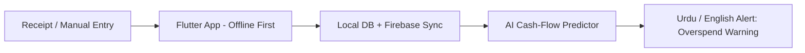

**Software Engineering Undergraduate · Riphah International University · Sahiwal, Pakistan**

---

## Recruiter Quick Scan — Everything in 10 Seconds

| What you are looking at | What you will find |
|---|---|
| **Strongest base** | OOP and problem solving — real projects in C++ and Python, not just tutorials |
| **Current focus** | Flutter, Clean Architecture, REST APIs, Firebase — industry-ready mobile development |
| **Best built project** | Personal Finance Manager — abstract classes, polymorphism, reports, 116 commits |
| **Next level** | Four future projects below — each with an AI, offline, or predictive feature |
| **Contact** | Portfolio and LinkedIn above — email is intentionally not in a public README, to avoid spam |

> **My principle:** Every project should either be something uncommon, or, if it is common, it must have a future feature that makes it different. Building a UI clone alone is not my goal.

---

## Tech Stack

| Category | Tools |
|---|---|
| **Languages** | C++ · Python · Dart · HTML · CSS · SQL |
| **Mobile** | Flutter · Dart · Responsive UI · State Management |
| **Backend (building)** | Django · MySQL · REST APIs · Firebase · JWT Auth |
| **Practices** | Clean Architecture · OOP & SOLID · Git & GitHub · Accessible UI |

---

## GitHub Activity

---

## What I Can Build For You

| Service | What I deliver |
|---|---|
| **Flutter Mobile Apps** | Clean UI, navigation, API integration, offline-first design |
| **UI / UX to Flutter** | Design to pixel-clean, responsive Flutter screens |
| **Console to Product** | Older C++ / Python logic rebuilt as a modern mobile or web product |
| **Portfolio & Landing Pages** | Fast, clean, mobile-friendly websites |
| **Backend Basics** | Django + MySQL APIs with authentication, so an app is not frontend-only |

---

## Built Projects — Already Complete

| Project | What it is | Stack | Status |
|---|---|---|---|
| **Personal Finance Manager** | OOP finance app — balance, categories, reminders, reports | C++ | Complete — [Repo](https://github.com/malikaliiraza/Personal-Finance-Manager-System) |
| **Bus Ticket Reservation** | Admin + booking, live seat map, role-based discounts | C++ | Complete — [Repo](https://github.com/malikaliiraza/Bus-Ticket-Reservation-System-) |
| **Quiz Quest** | Terminal trivia — 16 questions, 3 rounds, lifelines | Python | Complete — [Repo](https://github.com/malikaliiraza/Quiz-Quest) |
| **Apex Dash** | Rhythm obstacle game — auto-scroll, collision, score | Scratch 3.0 | Complete — [Repo](https://github.com/malikaliiraza/Apex-Dash) |
| **Portfolio Website** | My personal portfolio site | HTML · CSS · JS | Live — [Site](https://malikaliiraza.github.io) |

---

## Project Screenshots — Real Screenshots From My Own Repos

These images are loaded directly from the original project repos on the `main` branch, so they will stay in sync with those repos.

### Personal Finance Manager — Sample Run

### Bus Ticket Reservation System — Sample Run

### Apex Dash — Gameplay and Menu

> Note: Quiz Quest has no image file in its repo — only code and a text sample screen — so no screenshot was added for it, rather than using a fake or blank image.

---

## Future Projects — Roadmap, Not Fake Claims

> **Honest note:** The four projects below are in my **roadmap**, not complete yet. They are listed so a recruiter can see my direction, thinking, and ambition — not a fake completed list.

### 1. CashWise AI — Pakistan-first Finance Coach
**Not just another expense tracker.**
- PKR budgets, categories, and charts — offline-first Flutter app
- Receipt scan (OCR) for automatic entry
- **Future feature — AI Cash-Flow Predictor:** Predicts, before the month ends, when money will run out, warns before overspending, in Urdu and English

### 2. SafeRide Campus — University Bus Safety + Booking
**Not just seat booking.**
- Live bus location, seat booking, offline QR ticket
- **Future feature — AI Delay Predictor + Safety Alerts:** Predicts delays from route, traffic, and past data, and sends safe-arrival alerts to parents. Built as a niche solution for Pakistani universities

### 3. LearnLoop AI — Quizzes From Your Own Notes
**Not just another quiz app.**
- Upload a PDF or notes, AI generates a quiz from them
- Spaced repetition and weak-topic analytics
- **Future feature — AI Tutor:** On a wrong answer, it does not just say "wrong" — it re-explains the concept in simple Urdu or English

### 4. CropDoctor Offline — On-Device AI for Farmers
**Not just an information app.**
- Phone camera detects crop disease — offline, with on-device AI
- Urdu voice guidance: what the problem is, and what to do about it
- **Future feature — Mandi Price Predictor:** Shows price trends so a farmer can sell at the right time

**Backend for all of the above:** Django + MySQL REST API with JWT authentication — so these are real full-stack products, not UI only.

**Every new project will include:** README + screenshots / demo GIF + setup guide + clean architecture + tests where they make sense.

---

## My Roadmap

| Stage | Focus |
|---|---|
| **Done** | C++, Python, OOP, console products, Git basics |
| **Now** | Flutter, Clean Architecture, REST APIs, Firebase, UI/UX polish |
| **Next** | Django REST APIs, MySQL, AI features in Flutter apps, testing and deployment |

---

## My Approach

- Clean, readable code — more important than clever code
- Simple, consistent, accessible UI
- Solving a real problem — not just demoing a feature
- Small, regular progress — not bulk updates

---

### Let's Work Together

**Internships · Freelance · Flutter / Full-Stack Collaboration**

*Thank you for visiting my profile — work on the future projects above is in progress. Stay tuned.*

